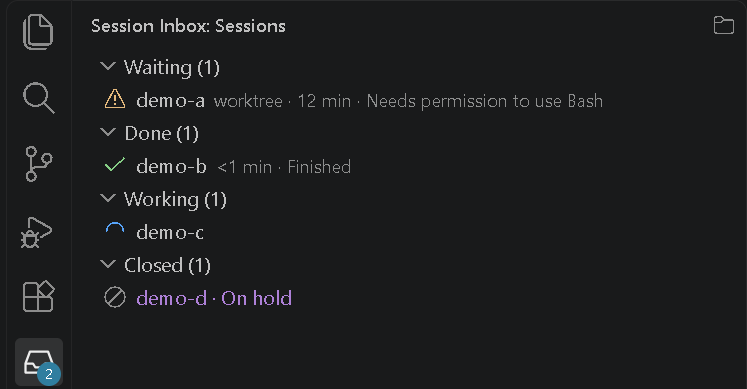

# Session Inbox

A persistent **"waiting on you"** inbox for Claude Code sessions across VS Code windows.

Desktop notifications from Claude Code are one-shot: you click one, get distracted, and forget
to go back and respond. Session Inbox keeps a visible indicator in every VS Code window that
stays until you actually act on each session.




## Features

### Status bar

- Shows `⚠ N waiting` (highlighted) or `✓ all clear` in every VS Code window, live.
- N counts sessions waiting on you (a permission prompt or a question) and finished replies: both
  are your turn.
- Hover for how many are waiting / done / working; click it to open the sidebar.
- A chat whose process has ended (window closed, or VS Code quit without the hook's cleanup) is
  not counted.

### Sidebar

- The Session Inbox icon in the Activity Bar (badge: waiting + done) opens a list of every running
  session across all windows. With none, it says "No Claude Code sessions running."
- **By state** (default): groups Waiting, Done and Working, in that order. Each session shows its
  folder, a `worktree` tag, how long it has waited, and its message.
- **By project:** a button in the sidebar's title bar switches to one header per project folder,
  A-Z, with a summary such as `1 waiting · 1 done` and its sessions underneath, each named by its
  state. The header's folder icon has the colour of its most urgent state: yellow waiting, green
  done, blue working, grey open. The choice is saved for all windows (others pick it up when they
  reload).
- **Project icons:** right-click a project header for **Set Icon…** (a pick of ~25 icons, such as a
  map or a globe) or **Reset Icon**. The icon keeps the state colour and changes in every open
  window at once. It's stored in the setting `sessionInbox.projects`
  (`{ "sc-map-library": { "icon": "map" } }`), where any other
  [codicon](https://code.visualstudio.com/api/references/icons-in-labels#icon-listing) name can
  be typed by hand.
- **"Open" chats:** a chat that is open but hasn't written a status yet (after a VS Code restart,
  or a new tab before its first prompt) is shown in grey as "Open", last (grouped by state: an
  "Open" group that starts collapsed). It isn't counted in the badge or the status bar, and moves
  to its real state with its next prompt or tool call.

### Where a project stands

Grouped by project, the first row under a project's header (a target icon) shows where that
project stands, with no setting: the `Now:` line of the `## Where we are` section in the project's
`docs/todo.md`.

```markdown
## Where we are
- Now: To do 31, step F3b4b (Run translated)
- Next: To do 37, 11, 59
- Updated: 2026-11-03
```

- Hover the row for the whole section, with a note when its `Updated:` date is more than 14 days
  old.
- The file is re-read with every session event and every 30 s, and never written. A project
  without that file or section simply shows no row.
- Kept elsewhere? Add `"focus": "notes/status.md"` to the project's entry in
  `sessionInbox.projects` (a markdown file, path relative to the project folder). A problem with a
  path set this way gets one line in the "Session Inbox" output channel.
- `"focus": false` turns the row off.

### Clicking a session

- Brings up the VS Code window that has the session's project folder open, or opens the folder in
  a new window if none has.
- Shows that chat's own Claude tab, not whichever Claude tab was last active.
- A session whose folder no longer exists (a removed worktree) shows "Folder not found" instead of
  opening it.
- Clicking a popup from your own `notify.ps1` can do the same (see
  [Optional: desktop popups](#optional-desktop-popups)).

### Reminders

- A session still waiting on a permission prompt or a question after 10 minutes gets its
  `notify.ps1` popup once more ("Still waiting (12 min): …").
- The setting `sessionInbox.renotifyMinutes` changes the minutes; `0` turns reminders off.
- The reminder is sent only by a window that has the chat's folder open and isn't in front, and can
  come up to ~30 s late.
- Needs a desktop-popup hook of your own (see
  [Optional: desktop popups](#optional-desktop-popups)). Without one, the first reminder that can't
  be sent says so once per window, with a **Turn Off Reminders** button.

### Tray icon (optional)

Off by default: turn on the setting `sessionInbox.trayIcon`.

- A Windows tray icon next to the clock shows the same count, also when no VS Code window is in
  front, in the sidebar's colours: yellow if any session is waiting, green if only finished
  replies are, grey when all clear. Hover for a summary.
- Click it for the list of sessions that need you (dark when Windows apps are set to dark), each
  with the sidebar's state icon and its project's icon. One opens its window and tab like a sidebar
  click (this needs VS Code's `code` command on PATH).
- It closes when the VS Code that started it quits, when the setting is turned off, or with
  **Exit** in its menu. After Exit it comes back when a VS Code window starts or the setting is
  turned off and on.
- Turn the setting off before uninstalling; otherwise the icon stays until VS Code quits.

## How it works

- **A global hook** (in `~/.claude/settings.json`) writes a small status file per session to
  `~/.claude/session-status/<session_id>.json` (project folder, worktree, state, message and
  timestamp) and updates it as the session moves between waiting, working and done.
- **The VS Code extension** watches that folder and shows what's in it in every window.
- Desktop popups are not part of Session Inbox: the status hook works on its own, next to any
  popup hook you already have, and never changes it.

## Requirements

- Windows (the hook and the tray icon are Windows PowerShell scripts).
- [Claude Code](https://docs.claude.com/en/docs/claude-code) with the VS Code extension.
- VS Code 1.100 or newer.
- Optional, for desktop popups and reminders: your own `~/.claude/hooks/notify.ps1` (not included).

## Install and run

1. **Extension:** download the `.vsix` file (such as `session-inbox-0.1.0.vsix`) from the
   [latest release](https://github.com/HaminKo/session-inbox/releases/latest) and install it with
   `code --install-extension session-inbox-0.1.0.vsix` (or Extensions view → `…` → Install from
   VSIX…).
2. **Hooks:** run **Session Inbox: Install Hooks** from the Command Palette (`Ctrl+Shift+P`).
3. New chats pick up the hook; restart chats already running. Each session then keeps a status file
   in `~/.claude/session-status/`.

What Install Hooks does:

- Copies the status-writer (bundled in the extension from `hooks/session-status.ps1`) into
  `~/.claude/hooks/` and adds it to `PermissionRequest`, `Stop`, `UserPromptSubmit`, `PostToolUse`
  and `SessionEnd` in `~/.claude/settings.json`, next to any hooks already there.
- Never changes other hooks or settings, and refuses a `settings.json` that isn't valid JSON.
- Saves the original once as `settings.json.before-session-inbox`, and backs up a replaced hook to
  `~/.claude/hooks/backups/`.
- At startup the extension warns when the hook is missing, differs from its own copy, or isn't in
  `settings.json` ("Install Hooks" / "Don't ask again", the latter until the bundled hook changes).

<details>
<summary>Setting up the hook by hand instead</summary>

In PowerShell, from a copy of this repo:

```powershell
New-Item -ItemType Directory -Force "$env:USERPROFILE\.claude\hooks" | Out-Null
Copy-Item hooks\session-status.ps1 "$env:USERPROFILE\.claude\hooks\"
```

Then, in `~/.claude/settings.json`, add a group with this entry to each of the 5 events above, next
to any groups already there (shown for `Stop`; the same for `PermissionRequest`,
`UserPromptSubmit`, `PostToolUse` and `SessionEnd`). Leave out `"async": true`: the hook has to run
in order, so that a late `working` can't overwrite `done`.

```json
{
  "hooks": {
    "Stop": [
      {
        "hooks": [
          {
            "type": "command",
            "command": "powershell.exe -NoProfile -ExecutionPolicy Bypass -File \"$USERPROFILE/.claude/hooks/session-status.ps1\"",
            "timeout": 10
          }
        ]
      }
    ]
  }
}
```

Verify with the payload test in [docs/research/hooks.md](docs/research/hooks.md) ("Verifying
without a live session").

</details>

## Settings

All three are user settings (the same in every window): change them in Settings (`Ctrl+,`, search
"Session Inbox") or in VS Code's user `settings.json`.

| Setting | Default | What it does |
|---|---|---|
| `sessionInbox.renotifyMinutes` | `10` | Minutes a session may wait on a permission prompt or a question before its popup is shown once more; `0` turns reminders off. See [Reminders](#reminders). |
| `sessionInbox.trayIcon` | `false` | The Windows tray icon next to the clock. See [Tray icon](#tray-icon-optional). |
| `sessionInbox.projects` | `{}` | Per project, keyed by the name its header shows (case ignored): `icon`, a codicon name (see [Sidebar](#sidebar)), and `focus`, another file for the focus row or `false` (see [Where a project stands](#where-a-project-stands)). Example: `{ "sc-map-library": { "icon": "map", "focus": "notes/status.md" } }`. |

## Optional: desktop popups

Session Inbox doesn't ship a desktop-popup hook. Reminders, and clicking a popup to show its chat,
work with one of your own at `~/.claude/hooks/notify.ps1` (a Windows PowerShell script; the author
uses a personal one that isn't in this repo). What it needs to handle:

- **Reminders:** the extension starts it as
  `powershell.exe -NoProfile -ExecutionPolicy Bypass -File ~/.claude/hooks/notify.ps1`, with
  `CLAUDE_PROJECT_DIR` set to the chat's project folder and this JSON on stdin (UTF-8):
  `{"hook_event_name":"SessionInboxReminder","session_id":"…","cwd":"<project folder>","message":"Still waiting (12 min): …"}`.
  Show `message` in a popup. Details: [docs/research/hooks.md](docs/research/hooks.md), "Re-notify".
- **Click shows the chat's tab (optional):** on a click, write
  `~/.claude/session-status/.reveal` as UTF-8 without BOM:
  `{"session_id":"…","project_dir":"<project folder>","at":<milliseconds since 1970>}`. The window
  that has that folder open shows the chat's own Claude tab if `at` is at most 15 s old. Details:
  [docs/research/hooks.md](docs/research/hooks.md), "Popup click shows the chat's own tab".

## Development

- **Build from source:** run `npm install` once in `extension/`, then `npm run package` (from
  `extension/`) for a `.vsix`. Needs Node.js 22.18 or newer (the unit tests run `.ts` files
  directly with `node --test`).
- **Run:** open the repo folder in VS Code and press `F5`: it type-checks and builds the extension
  (`npm run compile`) and starts an Extension Development Host with it loaded. That window has all
  other extensions turned off, Claude Code included, so showing a chat's own tab only works from
  the installed `.vsix`.
- **Checks** (from `extension/`): `npm run lint` (ESLint), `npm run check-types` (TypeScript),
  `npm test` (unit tests, plain Node, about a second).
- **GUI test** (from `extension/`): `npm run test:gui` starts a separate VS Code window with this
  extension (some tests add a stand-in for Claude Code) and checks the status bar, sidebar, Install
  Hooks, opening a session, its tab, reminders and the tray icon. It uses sample status files in
  temp folders (`SESSION_INBOX_STATUS_DIR`, `SESSION_INBOX_SESSIONS_DIR`), never your real
  `~/.claude/session-status/` or `~/.claude/sessions/`.
- **Screenshots** (from `extension/`): `npm run screenshots` (or `-- statusbar`, `-- sidebar`,
  `-- window` for one) saves PNGs to the temp folder (`session-inbox-shots`). The first run of this
  or the GUI test downloads VS Code (~350 MB) into `extension/.vscode-test/`.
- **How it's built:** each part is a numbered to-do, listed in [docs/todo.md](docs/todo.md), with
  details in [docs/todo/](docs/todo/).

## Changelog

What changed in each version: [CHANGELOG.md](CHANGELOG.md).

## Credits

- Grew out of the project author's own Claude Code desktop-notification hook (`notify.ps1`, not
  included), which it works next to rather than replaces.
- [Visual Studio Code Extension API](https://code.visualstudio.com/api) — Microsoft, MIT.
- [esbuild](https://esbuild.github.io/) — Evan Wallace, MIT.
- [Codicons](https://github.com/microsoft/vscode-codicons) — Microsoft, CC BY 4.0: the tray menu
  draws them from the font that ships with VS Code (not copied into this project).
- [ESLint](https://eslint.org/) — OpenJS Foundation, MIT.
- [typescript-eslint](https://typescript-eslint.io/) — typescript-eslint team, MIT.
- [TypeScript](https://www.typescriptlang.org/) — Microsoft, Apache-2.0.
- [@types/vscode and @types/node](https://github.com/DefinitelyTyped/DefinitelyTyped) —
  DefinitelyTyped contributors, MIT.
- [@vscode/vsce](https://github.com/microsoft/vscode-vsce) — Microsoft, MIT.
- [@vscode/test-electron](https://github.com/microsoft/vscode-test) — Microsoft, MIT.
- [Playwright](https://playwright.dev/) (`playwright-core`) — Microsoft, Apache-2.0.
- [Node.js](https://nodejs.org/) — OpenJS Foundation, MIT.

## License

MIT — see [LICENSE](LICENSE).
