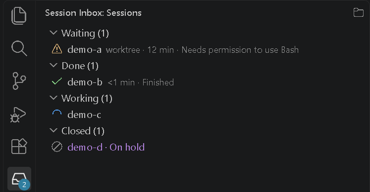

# Session Inbox

A persistent **"waiting on you"** inbox for Claude Code sessions across VS Code windows.

Claude Code's desktop notifications are one-shot. Session Inbox keeps a status bar item in every
VS Code window that stays until you act on each session that is waiting for you.

It shows a status bar count, a sidebar of every session across windows (click one to bring up its
window and chat tab), and an optional Windows tray icon. Install steps and settings:
[main README](https://github.com/HaminKo/session-inbox); every feature in detail:
[user guide](https://github.com/HaminKo/session-inbox/blob/HEAD/docs/guide.md).

## Requirements

- Windows.
- Claude Code with its VS Code extension, plus the Session Inbox status hook in
  `~/.claude/settings.json` (setup steps are in the
  [main README](https://github.com/HaminKo/session-inbox#install-and-run)).
- Optional: desktop popups and reminders need your own popup hook at
  `~/.claude/hooks/notify.ps1` (not included; the
  [user guide](https://github.com/HaminKo/session-inbox/blob/HEAD/docs/guide.md#your-own-popup-hook)
  says what it gets and writes).

## License

MIT — see [LICENSE](LICENSE).
